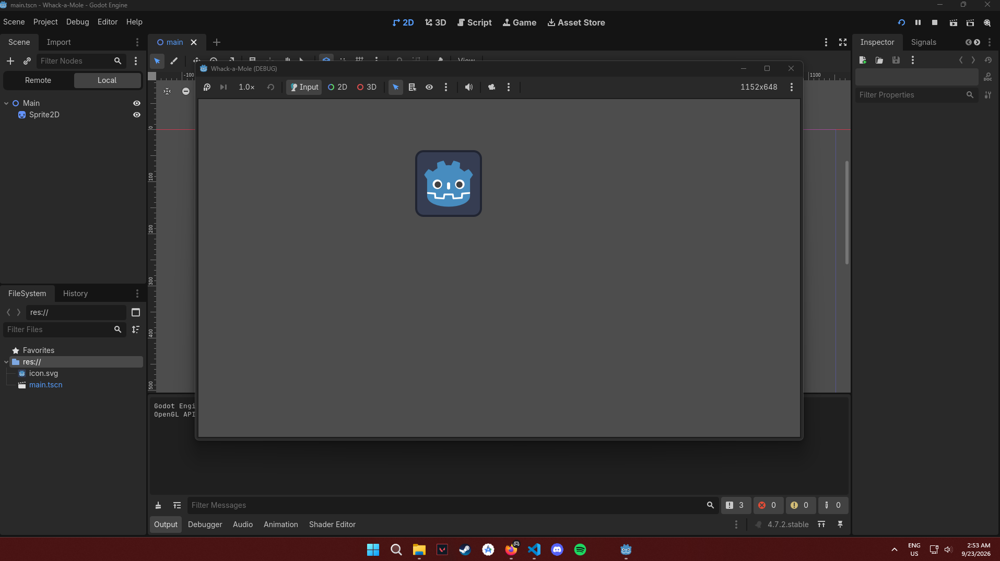
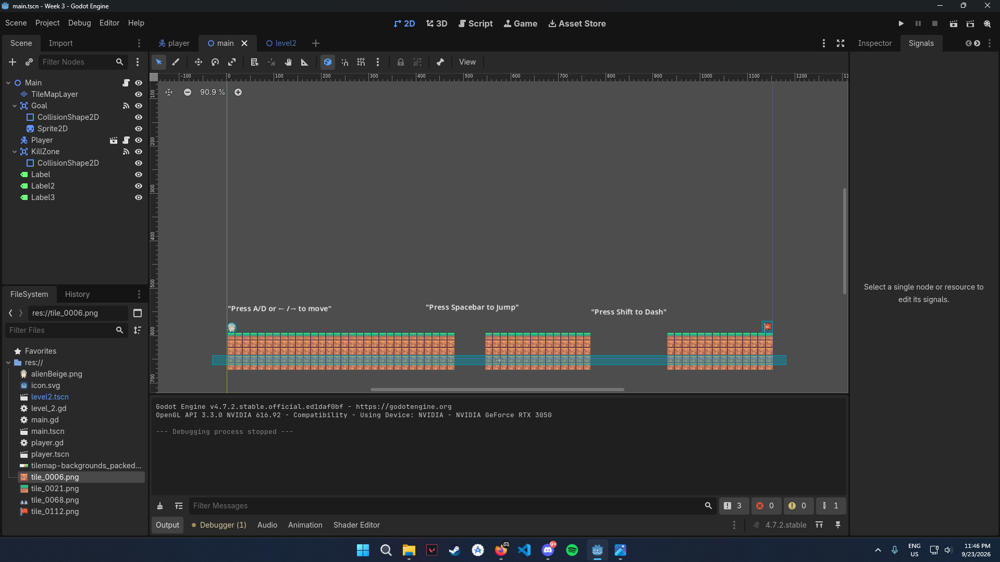
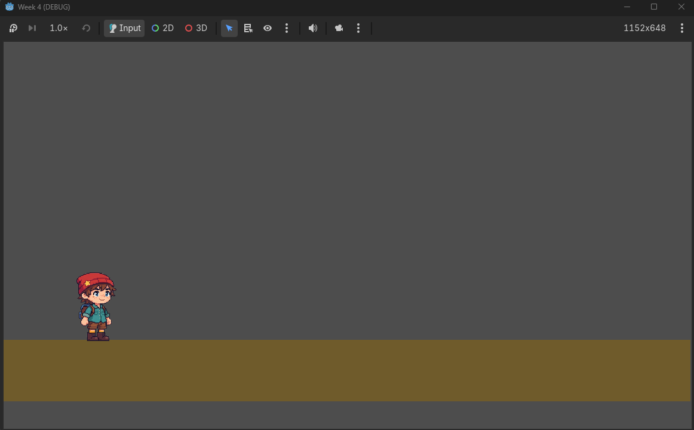

Whack-a-Mole is a pretty self explanatory game where, like the arcade version, users try to whack, or in this case, 
click moles as they randomly pop up from a hole. There will be a time limit. It is basically like an aim trainer since
I play a lot of aim-focused games, but since those are too common already, I decided to mix it up and make it into this
Whack-a-Mole game.

Week 1:

Week 2:

Week 3:

.png)
.png)
.png)

Week 4:
AI Used: Gemini
AI Prompt: Generate a character sprite Cute 2D side-view platformer character sprite, standing pose, simple flat colors, clean outline, plain white background, no shadow, game asset
Animations: Idle, Run, Jump, Dash, Dust Particles

.jpg)
.jpg)

Week 5:
Main Menu:

Settings:

Game:

Week 6:

The enemies changes color when they detect the player, they run into the player and then attack

The enemies get defeated when the player jumps on top of them like mario
