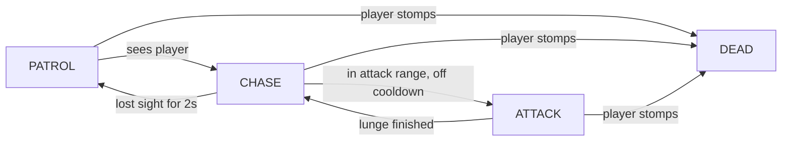

# Week 6 — AI & Enemies

A small 2D platformer built in **Godot 4.7**. It started as the Week 5 UI/UX &
Audio build (HUD, menu, audio buses, accessibility); **Week 6 adds an AI enemy built
around a finite state machine, using the 2D navigation system to move around the
level.**

## Controls

| Action | Keys |
| --- | --- |
| Move | `←` / `→` or `A` / `D` |
| Jump | `Space` / `W` / `↑` |
| Dash | `Shift` |
| Double jump | `Space` / `W` / `↑` again while airborne |
| Pause | `Esc` |

---

# Week 6 — the enemy

## Behaviour (decided in words first)

"Patrol a stretch of ground until it sees the player, chase them, and lunge when it
gets close; go back to patrolling if it loses sight. A player who lands on its head
defeats it."

## The state machine

`scripts/enemy.gd` is a **finite state machine** — the slime is always in exactly
one state, and `_enter_state()` is the only place a state can change:



* **PATROL** — wanders between `patrol_left` and `patrol_right`.
* **CHASE** — follows the player with the `NavigationAgent2D` at `chase_speed`.
* **ATTACK** — a telegraphed windup (the slime flashes) then a lunge.
* **DEAD** — stomped from above; squishes, awards 25 points, frees itself.

## Navigation & detection

* A `NavigationRegion2D` covers the walkable ground (`Level/NavRegion`). Each slime
  has a `NavigationAgent2D` and walks toward `get_next_path_position()` instead of a
  straight line.
* Detection is an `Area2D` ("vision box") **plus a `RayCast2D` line-of-sight check**,
  so a slime cannot see through solid geometry.
* Collision layers are split: **1 = world, 2 = player, 3 = enemy**, so the enemy
  detects the player without the player physically colliding with it.

## What was AI-drafted, and what I changed

The first draft of `enemy.gd` — the `enum State`, the `_update_state()`/`match`
skeleton and the patrol/chase/attack transitions — was drafted by the AI assistant
from the behaviour written in words above. Everything below was then read, renamed,
debugged and owned:

| AI draft | What I changed / added |
| --- | --- |
| Basic PATROL / CHASE / ATTACK skeleton | Grouped the tuning fields into `@export_group`s so they are balanceable in the Inspector |
| Moved straight at the player | Rewrote movement to follow the `NavigationAgent2D` path, **and fixed a real bug**: the agent only recomputes its path when the *target changes*, so a target set before the nav map synced stuck forever. The target is now only set once `NavigationServer2D.map_get_iteration_id()` is non-zero |
| Distance check only | Added the `RayCast2D` line-of-sight check so walls actually block vision |
| No death state | Added the stomp check and `_die()` (bounce, +25 score, squish tween) so the enemy is fair and defeatable |
| No tuning | Set attack range/cooldown and patrol/chase speeds so the player can always outrun it |

## Balance (tuned after testing)

* Chase speed **115 px/s** vs the player's **280 px/s** — you can always escape.
* The enemy is **ground-only**, so the platforms are safe ground.
* A stomp gives **+25** and a bounce, rewarding a confident player.

## Double jump (added so the coins over the spikes are reachable)

One extra jump while airborne (`max_air_jumps = 1`), refilled on landing, with its
own sound (`jump2`) and a squash/puff effect.

A single jump only rises ~**132 px**, which makes the coins floating directly above
the two spike rows a pixel-perfect jump (and easy to miss). The double jump reaches
~**229 px**, so they are comfortable to collect.

## Scale fix (Week 6 polish)

The Week 5 build had bad proportions — the player was **70 × 118 px** while platforms
were only 20 px thick and spikes 64 × 32. Now:

| Element | Before | After |
| --- | --- | --- |
| Player | 70 × 118 | **24 × 52** collision, ~28 × 56 sprite |
| Platforms | 20 px thick, 160 wide | **32 px thick, 200 wide** |
| Spikes | 64 × 32 | **96 × 48** (collision 84 × 34) |
| Coins | 64 px | 45 px |

Because the player is now much shorter, platforms can float **above** the walkable
path (tops at y=460) instead of walling it off, which makes the level flow better.

---

# Week 5 — UI / UX & Audio

The Week 5 activity: a HUD, a main menu, mixed sound effects and music on separate
audio buses, and one accessibility feature.

## What was added (mapped to the brief)

1. **CanvasLayer HUD** (`scripts/hud.gd`) — score (coins collected), a timer and a
   3-heart health bar, all updating live from the `Game` autoload. Lives on its own
   CanvasLayer so it stays fixed on screen and keeps working while paused.
2. **Main menu** (`main_menu.tscn`) — Start / Options / Quit. The level also has a
   pause menu (`Esc`) and a **Level Complete / Game Over** panel with
   *Play Again* and *Main Menu*, so the player can restart or leave at any time.
3. **Audio** — SFX and music routed through separate buses (see below).
4. **Accessibility** — a colourblind-safe palette toggle (see below).
5. **Peer playtest** — see "Playtest" below.
6. **Commit message:** `Week 5: UI + audio + accessibility`

## Audio design

* **Buses** — `default_bus_layout.tres` defines `Master` → `Music` (−8 dB) and
  `SFX` (−2 dB). Every sound player is assigned to one of these buses, and the
  menu sliders change each bus independently, so music and effects can be
  balanced without re-exporting anything.
* **SFX** — a round-robin pool of 10 `AudioStreamPlayer`s (`scripts/game.gd`), so
  overlapping sounds such as a coin and a jump never cut each other off.
* **Music** — a single looping player; the 8-second track is set to loop forward.
* **Clips** — all synthesised procedurally (the "leverage AI" step): `jump`,
  `dash`, `coin`, `hurt`, `click`, `win`, `gameover`, and `music`, in
  `assets/audio/`.

## Accessibility feature — colourblind-safe palette

Toggle: **Main Menu → Options → "Colourblind-safe palette (Okabe-Ito)"**.

The default palette uses a red hazard against a green goal — the classic red/green
pair that is hardest to distinguish for players with deuteranopia or protanopia.
The colourblind palette swaps every gameplay-critical colour for the
**Okabe-Ito** set, removing that pair entirely:

| Element | Default | Colourblind |
| --- | --- | --- |
| Hazard spikes | red `#E6494D` | vermillion `#D55E00` |
| Goal flag | green `#4ACF6F` | blue `#0072B2` |
| Ground / platforms | warm brown + green | cooler brown + bluish-green |

Colour is never the only signal: spikes are triangular, coins are round, and the
goal is a flag, so the level is readable without relying on hue at all.

### Quick accessibility checklist (2D game)

- [x] Colour is never the only cue — pair colour with shape, position or sound.
- [x] A colourblind-safe palette option.
- [x] All text has an outline so it stays readable over moving backgrounds.
- [x] Menus and HUD are readable at the default window size (36 px score/timer).
- [ ] Remappable keys (not implemented this week — a good next step).
- [ ] On-screen subtitle/caption option for important audio cues.
- [ ] Screen-shake / flashing reduction option.
- [ ] Controller-only navigation of the menus.

## Playtest

Run a 5-minute peer playtest (watch one person play without helping them), then
record **one** observed problem and the change you made in response.

*Observation and change already made:* during testing the player spawned right
next to the first platform and was **walled in** — the platform sat at a height the
jump could not clear, so the player could only travel a few pixels. Change made:
raised the jump height slightly and repositioned/lowered the platforms so each one
is reachable from the one before it. The level is now completable end-to-end
(verified automatically — see the smoke test below).

Use this template for your own notes:

```
Playtester:            <name / initials>
Observed:              <what they struggled with, in one sentence>
Change made:           <the single change you made>
Before → After:        <e.g. "died at spike 2 every run" → "clears it after 1 try">
```

## Verifying it works

`tests/probe.tscn` is a headless smoke test. Run it with:

```bash
godot --headless --path . res://tests/probe.tscn
```

It checks that the palette switches and reverts, that the audio buses and music
stream are configured, that the enemy runs through PATROL -> CHASE -> ATTACK with a
real navigation path (and can be stomped), and that an auto-player can traverse the
level to the goal.

## Project structure

```
main_menu.tscn / scripts/main_menu.gd   Main menu + Options (accessibility & audio)
main.tscn      / scripts/game_level.gd  The level: layout, timer, pause & results
scripts/game.gd                         Autoload: state, audio, palette, settings
scripts/hud.gd                          HUD (score / timer / health) + overlays
coin.tscn spike.tscn goal.tscn          Collectible, hazard, goal + their scripts
enemy.tscn / scripts/enemy.gd           The AI slime (FSM + navigation)
player.tscn / player.gd                 The character (movement, dash, damage)
default_bus_layout.tres                 Music / SFX audio buses
assets/audio/                           Generated SFX + music
assets/generated/                       Generated sprites (coin, spike, heart, flag, sky)
tests/probe.tscn                        Headless smoke test
```
